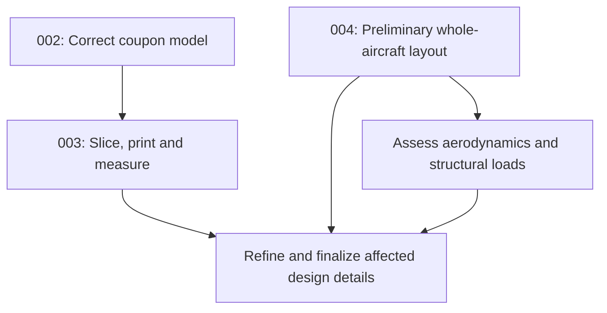

# Aircraft design and test plan

**Documented:** 2026-11-12  
**Purpose:** Define what can be designed before coupon testing, what evidence is needed before finalizing details, and how the work proceeds in parallel.  
**Starting repository state:** [aaa1f2dc7b46a351f5c547b0e8c5248ec1e83025](https://github.com/eugenelin89/cwsf2027-research/commit/aaa1f2dc7b46a351f5c547b0e8c5248ec1e83025).  
**Record type:** Engineering plan documented at the user's request before implementation. This document does not establish a new CAD model or test result.  
**Task status:** Maintained in the [Work prompt register](../prompts/README.md).

## 1. Working decision

**Develop a preliminary model of the complete aircraft while testing the small wing-section construction coupon in parallel.** Use the resulting measurements to refine the relevant dimensions, construction choices, and mass estimates before committing to the final manufacturing design.

Starting the whole-aircraft layout does not require a successful coupon print, access to the user's local Blender installation, or a fully validated flight wing. It does require visible assumptions, an editable design, and a clear distinction between a preliminary concept and a checked manufacturing release.

The wing and equipment layout must be developed together. Total mass affects the wing's aerodynamic and structural requirements, while component positions determine the aircraft's center of gravity (CG). The calculated CG must later be assessed against the range supported by the selected aircraft's aerodynamic and control analysis. A balance calculation alone does not establish stability. See the [aircraft architecture notes](../../docs/projects/ai-powered-adaptive-dynamic-soaring/03-aircraft-and-control-architecture.md) and [NASA's component-based CG explanation](https://www1.grc.nasa.gov/beginners-guide-to-aeronautics/aircraft-center-of-gravity/).

For example, a heavier battery or a different rear-mounted motor could change the required battery position, equipment-bay length, and mass budget. These are reasons to make an adjustable overall layout early and refine it with evidence.

## 2. What we currently have

The delivered `wing-section-v001` consists of two identical 40 mm span panel instances and one alignment pin: an 80 mm assembled construction coupon. The repository contains its parameterized source, STL/STEP parts, Blender scene, previews, and software checks. The [requirements](wing-section-v001-requirements.md), [build guide](wing-section-v001-build-and-test.md), and [independent review](../validation/2026-11-12-wing-section-v001-independent-review.md) define its evidence and limitations.

This coupon can help investigate printing, dimensional accuracy, spar/pin fit, actual part mass, assembly, and exploratory stiffness. Its modified symmetric thickness profile is a manufacturing surrogate. Extending or scaling it does not produce a validated flight wing.

The earlier approximately 850 mm flying wing remains a candidate. The final airframe configuration, wing airfoil and planform, component inventory, all-up mass, CG range, structural loads, and aircraft performance remain to be established. No body/equipment-bay model or full-aircraft assembly is created by this planning milestone.

## 3. What can we design before those tests?

The following table is the working scope for parallel development. “Finalize” means adopt the dimensions or assumptions for the intended manufacturing revision, with the supporting evidence recorded.

| Design work | Useful work that can proceed now | Evidence needed before finalizing the affected details |
| --- | --- | --- |
| **Overall aircraft shape and wing layout** | Develop an adjustable complete-aircraft concept: candidate span, area, planform, wing/body relationship, and control-surface locations. Compare alternatives where a choice is unresolved. | Mission requirements, estimated then measured mass, and aerodynamic/trim assessment at the intended operating conditions. Coupon printing does not select the airfoil or establish stability. |
| **Body or central equipment bay** | Reserve space for the battery, flight controller, receiver, ESC, wiring, connectors, and access openings. Use explicit component envelopes. | Actual component dimensions, mounting patterns, service access, connector clearance, and the mass/CG assessment. A product description or placeholder is not a measured fit. |
| **Battery, motor, propeller, and servos** | Establish provisional positions, an adjustable battery region, propeller clearance envelope, servo/control-linkage concepts, and attachment locations. | Exact hardware dimensions and masses, required movement/clearance, relevant attachment loads, and control requirements. |
| **Weight and balance** | Build a component mass budget, calculate preliminary CG, and explore the effect of uncertain weights and positions. | Weighed components and representative printed parts; an aerodynamically justified allowable CG range. The computed location and allowable range are separate outputs. |
| **Printed shells, spar channels, and panel joints** | Develop editable thicknesses, clearances, assembly concepts, and candidate print segmentation. | Actual material/process settings, coupon slicing and print observations, measured dimensions, fit, and mass. Later structural requirements may call for a different construction. |
| **Main spar, joints, and load-bearing attachments** | Map the intended load paths and candidate structural arrangements. Plan the calculations and representative specimens needed. | Declared load cases, appropriate structural calculations, material/component evidence, and representative physical checks. The short coupon does not qualify a full-span spar or aircraft joint. |
| **Final manufacturing files for the complete aircraft** | Prepare source structure and develop individual details as their inputs become available. | Resolve the evidence needed for each critical detail, confirm whole-aircraft integration, and record the selected revision and remaining limitations. A visually complete assembly is not a manufacturing or flight approval. |

Missing measurements should hold the decisions that depend on them. They should not automatically stop all preliminary layout, analysis, or documentation work.

## 4. Parallel workflow and numbered tasks

The task numbers are permanent identifiers. They are not a requirement to complete every lower-numbered physical activity before starting a higher-numbered concept task.

- **Coupon track:** [002](../prompts/002-wing-section-v001-review-fixes.md) resolves the documented software and instruction findings. [003](../prompts/003-wing-section-v001-slice-and-fit.md) then produces slicer evidence and the first physical observations when equipment is available.
- **Whole-aircraft track:** [004](../prompts/004-full-aircraft-preliminary-design.md) develops the integrated concept, component placement, and preliminary mass/CG model. It can proceed alongside 002 and 003. Coupon printing is not a prerequisite for completing this preliminary-layout milestone.
- **Integration:** Carry actual coupon and component measurements into later revisions. Develop the actual flight-wing aerodynamic and structural assessments together with the aircraft layout. Do not silently reuse unchecked modified coupon geometry or represent an unresolved review finding as fixed.

The register owns current statuses and completion links. Preparing a numbered handoff does not start a Work session, operate a printer, or mark its deliverables complete.

## 5. Expected result of the preliminary full-aircraft task

The useful outcome is a coherent, editable model showing how the complete candidate aircraft fits together, plus enough supporting information to review its assumptions. The first version should include the following.

### 5.1 Requirements and component inventory

Record the intended use, candidate configuration, and available design constraints. For each proposed component, record its name/model, quantity, dimensions, mass, intended location, mounting needs, source/date, and evidence status. Use distinct labels for **measured**, **manufacturer-specified**, **estimated**, **assumed**, and **unknown** values.

Do not convert an earlier shopping shortlist into a confirmed purchase. When hardware is unavailable, use explicitly labeled placeholder envelopes and reasonable sensitivity cases, with the assumptions and rationale recorded. Unknown masses must remain visible; they must not silently become zero.

### 5.2 Editable integrated layout

Show the candidate wing, body/equipment bay, spar route, control surfaces, battery, motor/propeller envelope, servos, electronics, cable routes, and access openings at a consistent scale. An unresolved tail or other configuration choice should be explicit rather than accidentally implied by a render.

Keep important dimensions parameterized. Declare the aircraft coordinate system and units, and document any transformation from the coupon's coordinates. Mark purchased components and placeholder objects distinctly from proposed printed parts. An assembly view should help the user inspect space, access, and relationships; it should not imply that every visible object is a printable deliverable.

### 5.3 Preliminary mass and CG model

Use a traceable component table to calculate total estimated mass and the position of its center of gravity. For one axis:

$$
x_{CG}=\frac{\sum_i m_i x_i}{\sum_i m_i}.
$$

Use the same origin, axis convention, and units as the CAD model. Explain how each component position is defined and whether it represents that component's own CG or an approximation. The formula is the component-weighted calculation described by [NASA](https://www1.grc.nasa.gov/beginners-guide-to-aeronautics/aircraft-center-of-gravity/).

Include the significant mass contributors, such as propulsion, battery, electronics, servos, spars, printed structure, wiring, connectors, and fasteners. Explicitly identify allowances and omitted/unresolved items. Use bounded scenarios for uncertain masses and battery positions where the bounds have a stated basis. Do not present a model of only the known components as the final all-up mass.

Report the calculated CG and the proposed battery-adjustment region. If an acceptable aerodynamic CG range has not been established, label it unresolved. Do not adopt an unexplained generic percentage of chord as proof that this candidate flying wing will be stable.

### 5.4 Views, checks, and decisions

Provide an assembled preview and dimensioned top/side views showing the main dimensions, component placement, and coordinate reference. Add an exploded or internal view when it clarifies assembly or access.

Check the actual source and outputs for units, scale, expected dimensions, component-envelope conflicts, intended movement/propeller clearances, and consistency with the mass/CG calculation. Record the methods and limitations: bounding-envelope checks against assumed components do not establish measured hardware fit.

Provide regeneration/viewing commands, actual tool versions, the checked source revision, and a short decision list covering unresolved aerodynamic, structural, component-fit, and manufacturing questions. If local apps are inaccessible, a cloud-generated source model and previews remain useful deliverables. Record what the available tools actually produced.

## 6. How coupon measurements influence the design

Use the existing [print and fit sequence](wing-section-v001-build-and-test.md#print-and-fit-sequence): one panel and one pin first; measure and review their fit; then one additional matching panel. The assembled coupon uses two panels and one pin total.

| Observation | Design decision it can inform | What it does not establish |
| --- | --- | --- |
| Slicer paths and actual wall quality | Whether the proposed material/process and local wall features are practical; candidate shell or web changes. | A selected flight airfoil or reliable whole-aircraft aerodynamics. |
| Measured bores, spar, pin, and joint fit | Clearance allowances, alignment features, assembly method, and the need for revised interfaces. | Qualified joint retention or a flight-load rating. |
| Actual printed mass | Improved density/process assumptions and manufacturing mass estimates for comparable features. | Final aircraft mass by simply multiplying the coupon weight by span; the full design has different geometry and components. |
| Recorded local bending/assembly response | Identification of slip, deformation, fixture issues, and questions for a better structural test. | Full-wing strength, fatigue life, aeroelastic behavior, or a reliable material modulus from this short assembly. |

Record specimen IDs, material, printer/nozzle, settings, source/export revision, instruments, photographs, and any sanding, reaming, adhesive, or other modifications. Preserve raw observations when the design or interpretation changes. The [observation template](../validation/wing-section-v001-observations-template.md) is a blank form until actual measurements are entered.

Small prototypes are useful because they answer specific questions before the full design is built. This is consistent with [NASA's explanation of physical prototyping](https://science.nasa.gov/eclips/videos/from-idea-to-physical-prototype/) and the [JPL engineering design process](https://www.jpl.nasa.gov/edu/resources/image/engineering-design-process-flow-chart/). The particular tests and dependencies above are recommendations for this project, not NASA certification criteria.

## 7. Evidence gates and completion boundaries

### Gate A — Preliminary layout complete

The concept task is complete when its integrated editable layout, component/assumption table, preliminary mass/CG analysis, views, executed software checks, and unresolved-decision record are committed and verified remotely. The model must be understandable and reproducible in its stated environment.

Unfinished physical tests, unmeasured hardware, and an unresolved allowable CG range can remain open at this stage when clearly labeled and reflected in the design's limitations. They must not be disguised as verified values. A successful coupon print is not an acceptance requirement for this gate.

### Gate B — Affected manufacturing details ready to adopt

Before adopting final shells, fit interfaces, mounts, joints, or load-bearing geometry, obtain the measurements and analyses relevant to those details. Where a new construction differs materially from the coupon, test a representative feature or assembly instead of assuming the earlier coupon covers it.

Track the decision, required evidence, evidence path, resulting design revision, and remaining uncertainty. A missing result can keep one interface provisional while unrelated layout work continues.

### Gate C — Integrated aircraft validation

A later complete-aircraft build requires its own integration and structural/functional checks. Any flight suitability or performance claim requires evidence appropriate to the actual aircraft and operating conditions. Passing Gates A or B does not establish dynamic-soaring capability, endurance, or an adaptive-controller advantage.

The scope of later physical validation must follow the selected science question. Outdoor dynamic soaring is not automatically required to complete a rigorous simulation study with bounded physical evidence, as the [project brief](dynamic-soaring-project-brief.md#26-fw-01-and-the-physical-aircraft-track) explains.

## 8. Planned file locations and handoff

These are destinations for future task outputs, not files claimed to exist now. Paths are relative to `GVRSF2027/`.

| Planned location | Intended contents |
| --- | --- |
| `design/cad/aircraft-layout-v001/` | Editable layout generator/model, parameters, component inventory, and mass/CG calculation inputs and outputs. |
| `design/blender/` | A clearly named aircraft-layout scene/import script when supported by the actual tools. |
| `design/previews/` | Dimensioned overall, internal, or assembly views labeled as preliminary. |
| `design/exports/aircraft-layout-v001-concept/` | Optional meaningful CAD exchange files for the concept, explicitly separated from manufacturing exports. |
| `docs/aircraft-layout-v001-design-notes.md` | Assumptions, component sources, reasoning, open decisions, and regeneration/viewing instructions. |
| `validation/` | Dated executed checks linked to source/configuration hashes and the eventual verified commit. |

Do not create a configured slicer-project claim from a geometry-only file. Printable STLs are not required to complete a preliminary layout. Preserve the reviewed coupon and keep any accepted geometry changes traceable by revision.

At each completed milestone, report what was delivered, what was checked, what remains provisional, the branch/full commit SHA, and its verified GitHub link. Follow the existing repository publishing rules and preserve unrelated work.

## 9. Relationship to Christopher's science work

This plan concerns aircraft development and manufacturing evidence. Christopher's experiment plan, mechanism papers, simulator physics checks, conventional baseline, and fair controller comparison continue on their own evidence-based sequence. A detailed aircraft render or a successful print does not replace those tasks or demonstrate an AI advantage.

The documented next design goal is an **adjustable complete-aircraft layout developed alongside the coupon work**, followed by revisions supported by measurements and analysis. Task execution status remains in the register.

[Project workspace](../README.md) · [Work prompt register](../prompts/README.md) · [CAD decisions](cad-decisions.md) · [Independent review](../validation/2026-11-12-wing-section-v001-independent-review.md)
