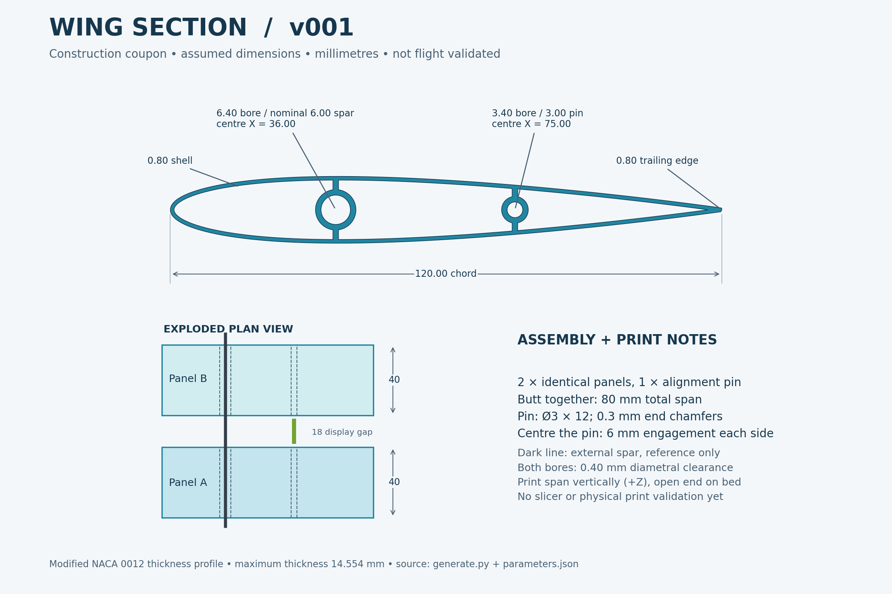

# Wing-section v001 — build, print and measure

**Status, 2026-11-12:** generated and geometry-checked construction coupon. Slicing, printing and physical measurements are pending. Start with the [requirements](wing-section-v001-requirements.md) and [verification record](../validation/2026-11-12-wing-section-v001.md).



## What to use

| File | Purpose |
| --- | --- |
| [parameters.json](../design/cad/wing-section-v001/parameters.json) | Editable dimensions and labelled assumptions. |
| [generate.py](../design/cad/wing-section-v001/generate.py) | Authoritative parametric solid model and geometry checks. |
| [profile-coordinates.csv](../design/cad/wing-section-v001/profile-coordinates.csv) | Generated outer section coordinates in mm; inspect/export to other CAD. Regeneration overwrites these coordinates. |
| [panel.stl](../design/exports/wing-section-v001/panel.stl) | Print **two identical copies** after the first fit check. |
| [alignment-pin.stl](../design/exports/wing-section-v001/alignment-pin.stl) | Print **one** chamfered pin. |
| [panel.step](../design/exports/wing-section-v001/panel.step), [alignment-pin.step](../design/exports/wing-section-v001/alignment-pin.step) | Solid CAD exchange, mm; round-trip checked. |
| [wing-section-v001.blend](../design/blender/wing-section-v001.blend) | Blender 4.3.2 exploded inspection scene, with a reference-only external spar. |
| [Blender script](../design/blender/import-wing-section-v001.py) | Rebuild the scene from the checked STL, verify scale, and render. |
| [Proposed slicer setup](../design/printing/wing-section-v001/README.md) | Settings to inspect locally; not a tested preset. |

Print from the two STL files, not from the exploded Blender assembly. The dark spar in the scene is an assumed external part, not supplied printable geometry. No configured 3MF or geometry-only 3MF is included.

## Geometry and coordinate convention

X runs from leading edge (0) to trailing edge (120 mm), Y is thickness, and Z is span. One panel occupies Z=0–40 mm; a second identical panel moves to Z=40–80 mm for the butt joint. Bores are parallel to Z. STL has no intrinsic units: import as **millimetres at 100% scale**. The panel should be **120 × 14.5536 × 40 mm**. The pin is **3 × 3 × 12 mm** before mesh approximation.

The shell is a 0.8 mm inward normal offset of a 161-vertex outer polygon, with solid closure regions at the leading/trailing edges. Integrated sleeves have 1.2 mm walls, attached by 1.2 mm-wide webs. The 6.4 mm spar bore is at X=36 mm; the 3.4 mm pin bore at X=75 mm. Both allow 0.4 mm **diametral** clearance relative to their assumed 6.0/3.0 mm parts (0.2 mm radially). Printer error and real hardware variation may consume this allowance.

The profile uses the symmetric NACA four-digit thickness polynomial with t/c=0.12, cosine sampling, and a linear added half-thickness `0.2488*u` mm at the default parameters (`u=X/chord`). This changes the baseline trailing edge to 0.8 mm and increases the maximum sampled thickness to 14.5536 mm. It is explicitly a **modified construction profile**, not an unmodified NACA 0012 or a chosen airfoil for a tailless aircraft. Source: [PDAS](https://www.pdas.com/naca456thick4.html); the additive modification is our design choice.

## Regenerate

Tested: Python 3.12.14, CadQuery 2.7.0, OCP 7.8.1.1, NumPy 2.3.5, Matplotlib 3.10.8 and Blender 4.3.2. No new packages were installed for this session. A separate virtual environment is recommended on another computer. From the repository root:

```bash
python -m venv GVRSF2027/.venv
source GVRSF2027/.venv/bin/activate
python -m pip install -r GVRSF2027/design/cad/wing-section-v001/requirements-preview.txt
python GVRSF2027/design/cad/wing-section-v001/generate.py
python GVRSF2027/design/cad/wing-section-v001/check_variants.py
python GVRSF2027/design/cad/wing-section-v001/preview.py
blender --background --python GVRSF2027/design/blender/import-wing-section-v001.py
```

On macOS, if Blender is installed in the standard Applications folder but is not on PATH, substitute `/Applications/Blender.app/Contents/MacOS/Blender` for `blender` after confirming that location and version. This Mac command was not executed here. In Blender's Text Editor, the script must be opened/saved as the repository script so its filesystem path is available.

The first command overwrites the canonical v001 exports, coordinate CSV and geometry JSON. For experiments, copy the parameters and use an output directory outside the checked revision:

```bash
python GVRSF2027/design/cad/wing-section-v001/generate.py --params /path/to/variant.json --output-dir /path/to/scratch-exports
```

Record a new revision before accepting changed geometry as a deliverable. Source/parameter SHA-256 values and export SHA-256 values are in the geometry report. STEP headers and Blender scenes can contain time-dependent metadata; geometric reproducibility is checked by dimensions, volume and topology, not a promise of byte-identical files across systems. The current preview script is dimensioned for the v001 defaults; update its labels/layout for a new revision. CAD parameters remain the authority.

## Print and fit sequence

1. Confirm the real printer, nozzle, filament and measured spar diameter. Default assumptions are standard PLA and a 0.4 mm nozzle. Foaming LW-PLA requires a separate calibrated profile; do not reuse the density or flow assumption.
2. Import one panel and one pin into Bambu Studio. Set STL units to mm; verify the dimensions above. Keep **span Z vertical**, with the open panel end at Z=0 on the plate. Print the pin upright. Do not lay the panel on its curved skin.
3. Review the [proposed settings and layer-preview checklist](../design/printing/wing-section-v001/README.md). Save the actual configured slicer project under `design/printing/wing-section-v001/` once checked. Record slicer version and all overrides.
4. Print and cool the parts. Remove brim/first-layer burrs before measuring. Test fit without forcing or drilling the bore first. If it binds, record where and by how much; any sanding/reaming changes the evidence and must be logged.
5. Slide a measured nominal 6 mm spar/gauge through the first panel; test the printed pin in its bore. Only then print the second identical panel. A different spar needs changed parameters, not an assumption that the current bore fits.
6. Put both panels on the common spar, align the rear pin, and bring the flat ends together. Mark the pin midpoint and aim for 6 mm engagement per side. Through-bores do not retain the pin axially: this is a hand-assembled fit demonstration. Record any temporary tape or adhesive; no permanent retention or load-rated joint is designed.

## Measurements to record

Use [the blank observation form](../validation/wing-section-v001-observations-template.md). Record instrument resolution and specimen IDs before testing.

- Weigh each panel and pin separately; record whether brim/adhesive is included. Calculated full-density PLA values are **12.3313 g per panel** and **0.1042 g per pin**, or **24.7668 g for two panels plus pin**, assuming 1.24 g/cm³. These exclude the spar, adhesion aids and waste; they are neither slicer estimates nor measurements.
- Measure chord, maximum thickness and span; measure accessible shell/web thickness where practical. Measure spar OD at multiple positions and orientations. Gauge bore fit rather than relying on caliper jaws inside a small hole.
- Record easy slide / friction / bind, alignment-pin fit, joint gap and visible twist. Photograph the assembly with a scale.
- For an exploratory stiffness check, rotate the assembled span horizontal with thickness Y vertical. Use padded supports/saddles spanning the chord at stated span positions (for example Z=10 and 70 mm) and a broad loading saddle near Z=40 mm. Document the actual arrangement and its motion. Start with a small measured load, increase gently within a predeclared non-damaging pilot limit, and stop at cracking, slipping or permanent deformation. No safe flight load is inferred here.
- Record force (N), loaded deflection, unloaded residual deflection, load duration, spar identity, joint treatment and repeat number. If motion is below instrument resolution, report it as unresolved. No reliable flexural modulus is implied by this short assembled coupon. Later comparisons require independently printed specimens and a frozen fixture/load protocol.

The next design change should follow these measurements. Full-aircraft geometry still needs a mass budget, aerodynamic/trim analysis, spar selection and actual component interfaces.
